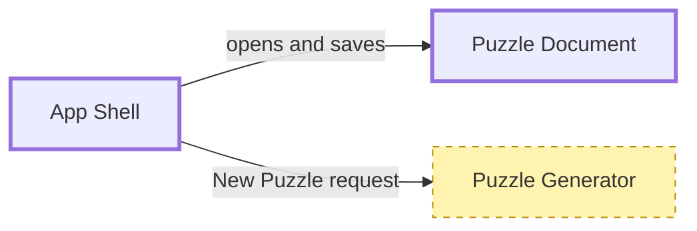

# Diagrams in the design docs

Shared by `system-design` (the Overview and subsystem docs) and `roadmap-plan-next-rung` (rung briefs). A diagram is there to show structure a reader would otherwise rebuild in their head from prose; anything else is decoration that goes stale.

## When a diagram earns its place

- **Block diagram:** the Overview always has one, because components and their connections are the system's shape. A rung brief has one when it touches two or more components or adds a connection. A subsystem doc always has one, for its own components.
- **Sequence diagram:** when the order of an interaction is the risk (a save round-trip, a sync handshake, an export pipeline), not for a single call.
- **No diagram:** one component with no new connections. Say it in a sentence.

One block diagram per document. If you want a second one, the document is covering two things; split it or drop the less useful view.

## Format

Default to Mermaid in a fenced ` ```mermaid ` block inside the markdown, so the diagram lives in the same file, diffs as text, and renders on GitHub and in most editors. Use `flowchart LR` or `flowchart TB` for block diagrams and `sequenceDiagram` for interactions. Avoid ASCII art except for a tiny inline sketch.

Rules that keep diagrams consistent across documents:

- **Node labels are the component names from the Overview, exactly.** "PDF Exporter" in the Overview is "PDF Exporter" in every brief, so a reader can match them and a search finds both. Node IDs are the same name without spaces (`PDFExporter`).
- **Edges say what crosses** in a short label (`GridSnapshot`, `Export command`, `.sudoku file`), not "uses".
- **Each doc shows its own level only.** A subsystem is a single box in its parent's diagram, given the `subsystem` class (and a `Doc` link in the component table). Never draw another doc's inner components. A subsystem doc may show outside callers or dependencies as single boxes, to mark its boundary. A rung brief that works inside a subsystem may draw that subsystem's inner components, with everything outside it as single boxes.
- **Show depth with classes.** Every component node gets one depth class. A rung brief also marks what it creates or changes as `touched` and shows only the neighbours needed to understand those edges.



Depth classes: `sketched` (dashed border: named with a responsibility, no design yet), `designed` (thin solid: a rung brief defines its interface), `built` (bold: exists in code and verified by a finished rung). A built component that a later rung changes stays `built`. Tags are per doc. A subsystem box is `sketched` until its doc exists, `designed` once that doc is agreed, and `built` when a fold-back verified it. The `subsystem` class (blue fill and border color) marks a box that has, or will have, its own doc; it only sets colors, so it combines with the depth class, and `touched` overrides its fill in a brief.

## Keep the syntax simple

Mermaid fails on some characters in bare labels. Quote every label (`Node["Label"]`), and avoid parentheses, brackets, colons, `#` and `;` inside labels and edge text unless the label is quoted. Declare `classDef` lines before the nodes. Stacking a depth class, `subsystem`, and `touched` on one node (as in the examples here) has been render-checked.

## Render-check

When `mmdc` (Mermaid CLI) is available, check every block you wrote or changed: extract it to a file and run `mmdc -i diagram.mmd -o /tmp/check.svg`. `mmdc -i file.md -o out.md` also renders every block in a markdown file, which is quicker for a whole doc. Fix any error before showing the doc.

When `mmdc` is not available, keep the syntax to the simple forms above and tell the user the diagram was not render-checked. Offer `npm install -g @mermaid-js/mermaid-cli` once; never install it silently.

## Graphviz fallback

When a diagram is too dense for Mermaid's layout (roughly more than 15 nodes, or many crossing edges), use Graphviz instead. Save the source and the render beside the doc, and link the image:

```bash
mkdir -p <DocDir>/SystemDesign/diagrams
dot -Tsvg <DocDir>/SystemDesign/diagrams/overview.dot -o <DocDir>/SystemDesign/diagrams/overview.svg
```

Link it with `` and keep the `.dot` file as the source of truth; re-render when it changes. Mirror the depth classes with `style=dashed`, `penwidth=1` and `penwidth=3`, and `touched` with `style=filled, fillcolor="#fff3b0"` (combine as `style="dashed,filled"`), and `subsystem` with `peripheries=2` (double border). If `dot` is not installed (`brew install graphviz` on macOS), stay with Mermaid and simplify the diagram instead.
