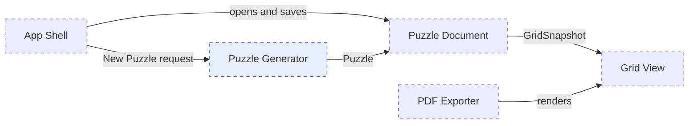

# Overview template

File: `<DocDir>/SystemDesign/Overview.md`. About one page: a thin outline of the whole system that is honest about what is unknown. It is enough to order a roadmap; detail is added per rung by `roadmap-plan-next-rung`, in rung briefs, and in a subsystem doc beside this file when a piece warrants its own design (see [subsystems.md](subsystems.md)). The Overview treats each subsystem as one component, so it stays a page however large the system gets.

IDs are per document, unique within it, and never reused or renumbered: `A` assumption, `D` decision, `R` risk, `Q` open question, `FR`/`NFR` requirements. Cite another doc's IDs qualified by its name (`Puzzle_Generator:R1`).

## Template with example

The example is a printable Sudoku app for macOS, as it stands once the roadmap exists and before any code is written. Keep each section to a few lines or a small table.

````markdown
# System overview: Sudoku Printer

Status: draft | agreed (<date>)
Mode: new | as-is (adopted <date>)
Platform: macOS 14+, SwiftUI
Roadmap: ../Roadmap-Sudoku_Printer.md (once it exists)

## Summary
A Mac app that generates Sudoku puzzles of a chosen size and prints them cleanly for people who solve on paper.
Success looks like: a 9×9 puzzle with a unique solution prints on one page in under 2 seconds; digits are readable at arm's length; saved puzzles reopen unchanged.

## Scope
| In (this version) | Later (wanted, not this version) | Out (not this project) |
| --- | --- | --- |
| 9×9 generation with difficulty | 4×4 and 16×16 grids | Solving on screen |
| Print and PDF export, US Letter | A4, several puzzles per page | iOS app |
| Save and reopen puzzles | Puzzle books | Online sharing |

## Headline requirements
Only those that constrain the design.
- FR1 (must): generate a 9×9 puzzle with exactly one solution.
- FR2 (must): print a puzzle as vector output.
- NFR1: digits legible at 9 mm cells when printed; matters because paper is the product.
- NFR2: generation under 2 s on an M1; matters because users generate several to pick one.

## Focus areas
1. Puzzle Generator: uniqueness and speed are unproven.
2. Print fidelity: the printed page is what users judge.

## Components


| Component | Responsibility | Depth | Doc |
| --- | --- | --- | --- |
| App Shell | Document-based app, menus, windows | sketched | none |
| Puzzle Document | The puzzle file: grid, givens, difficulty; JSON | sketched | none |
| Grid View | Draws a grid and its digits on screen and into PDF | sketched | none |
| Puzzle Generator | Swift package. Contract: `generate(difficulty:seed:) -> Puzzle` with exactly one solution; owns FR1, NFR2 | sketched | pending |
| PDF Exporter | Lays out one page and writes vector PDF | sketched | none |

## Subsystems
| Doc | Parent | Status |
| --- | --- | --- |
| Puzzle_Generator.md | Overview | pending (written when L4 designs its internals) |

## Decisions
| ID | Decision | Kind | Status | Why | Revisit when |
| --- | --- | --- | --- | --- | --- |
| D1 | Document-based app; the puzzle file is the data | choice | accepted | users save and reopen puzzles | sync is wanted |
| D2 | Generator lives in a Swift package with no UI dependency | choice | accepted | provable by tests alone | never |

## Assumptions
| ID | Statement | Status | If wrong |
| --- | --- | --- | --- |
| A1 | Personal use, no App Store distribution yet | assumed | sandbox and signing rungs move early |
| A2 | Backtracking generation is fast enough for 9×9 | assumed | need a smarter generator; L4 grows |

## Risks (ranked)
| ID | Unknown | Impact | Uncertainty | Cheapest experiment | Depends on |
| --- | --- | --- | --- | --- | --- |
| R1 | Generator uniqueness and speed | H | H | Generate 100 puzzles in a test; check uniqueness and time each | Swift package |
| R2 | Printed text fidelity | M | M | Render digits at print size; print one page | a drawn grid |

## Open questions
- Q1: Is difficulty user-chosen or random per puzzle?

## Traceability
| Requirement | Rung | Status |
| --- | --- | --- |
| FR1 | L4, via Puzzle_Generator (doc pending) | planned |
| FR2 | L3 | planned |
| NFR1 | L3 | planned |
| NFR2 | L4, via Puzzle_Generator (doc pending) | planned |
````

## Notes

- **Depth tags** belong to this doc and say how far each of its components is designed. `sketched`: named with a one-line responsibility. `designed`: a rung brief defines its interface. `built`: it exists in code and a finished rung verified it. A subsystem box is `sketched` until its doc exists, `designed` once that doc is agreed, and `built` when a fold-back verified it. A new project starts all `sketched`; an adopted one tags what exists as `built`. A built component that a later rung changes stays `built`. Tags move only in `roadmap-plan-next-rung` (to `designed`) and its fold-back (to `built`), so the Overview always shows where the design is thin.
- **Doc** is a link to the component's subsystem doc, `pending` when the component meets a subsystem trigger (a separate build target, its own owner or lifecycle, its own requirements and risks, or more than about five inner parts) but no rung has needed its doc yet, or `none` when it stays a row.
- **Subsystems are contract only.** A subsystem's row holds its responsibility, a `Doc` link, and a Contract summary (interface and the requirements it owns); its internals live in its own doc and never here. Edit this doc for a subsystem only when its Contract changes.
- **Subsystems** indexes every subsystem doc at any depth, since the files are flat and each names its parent.
- **Kind** is `choice` for an ordinary decision and `shift` for a change of direction from the current system (adopt mode). The roadmap must cover every accepted `shift` with a rung.
- **Cheapest experiment** is the field the roadmap reads most closely. Write it as something that visibly works or fails, not as a worry.
- **Depends on** records what must exist before the risk can be tested. It decides roadmap order.
- **Traceability** covers this doc's own requirements only. It is drafted with `none` in the Rung column; `risk-first-roadmap` fills it in, and fold-back sets the status (`planned`, `proven by L4`, `gap`). A requirement allocated to a subsystem reads `L4, via Puzzle_Generator`; while that subsystem's doc is `pending`, `L4, via Puzzle_Generator (doc pending)` is coarse coverage, and writing the subsystem doc must refine it into that doc's own requirements.
- A confirmed assumption stays with status `confirmed`, so the reasoning survives. After agreement, change things through the decision log, not silent edits.
- Diagram rules and the Graphviz fallback are in the `roadmap-plan-next-rung` skill's [diagrams.md](../../roadmap-plan-next-rung/references/diagrams.md).

## Deepen on demand

Leave these out of an outline. Add one to the Overview only when it is truly whole-system (it spans many components) and a rung or the user needs it now; otherwise the detail belongs in a rung brief or a subsystem doc. In `full` depth, include all of them up front.

- **Users and key flows:** primary user, then 2–3 flows as "user does X → system does Y → user sees Z". Flows show which entities matter.
- **Key entities and data model:** each entity's purpose, key fields, owner, and lifetime; relationships; authoritative versus derived data; what is persisted where; file formats the user sees. Names and ownership, no full schemas.
- **Interfaces:** module boundaries and what crosses them; external file formats, network APIs, OS integrations. Direction only.
- **Technology direction:** a table of area, choice, why, and the rejected alternative.
- **Verification strategy:** how each important thing will be known to work (unit tests, snapshot or UI checks, manual checks, measurements). Feeds rung `Done when` lines.

## Migrating a legacy Design file

An older `<DocDir>/Design-<Topic>.md` maps onto this layout as: Summary, Scope, Focus areas, Requirements (headline only), Constraints and assumptions, Risks, and Decision log go into the Overview; the architecture sketch becomes the Components diagram and table, tagged by what is built; entities, interfaces, technology, and verification stay in the Overview under their deepen-on-demand headings, or move to a subsystem doc when they belong to a piece that warrants one. Keep IDs unchanged. Write the new file beside the old one and leave the legacy file untouched; the user deletes it when satisfied.
