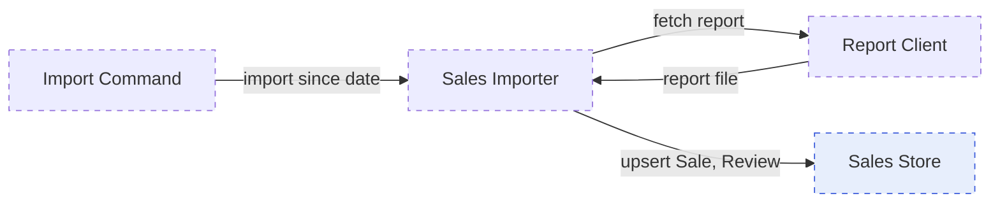

# System design template

File: `<DocDir>/SystemDesign/Overview.md` (the file keeps this name; skill text calls it the system design). It holds what the owner and agent agreed for the current milestone: subsystems and build targets, the seams between them, the data model, names, threat and privacy, and the decisions and risks behind them. Its size is bounded by the current milestone, not by a page count: later milestones get one line each, and detail inside the agreed seams is written in rung briefs, or in a subsystem doc beside this file when a piece warrants its own design (see [subsystems.md](subsystems.md)). Terms are defined in [terms.md](terms.md).

Table cells stay under about 400 characters: one decision, risk or traceability row is one line, and the reasoning goes in the rung brief or subsystem doc, linked from the cell.

IDs are per document, unique within it, and never reused or renumbered: `D` decision, `R` risk, `Q` open question, `FR`/`NFR` requirements, `A` assumption (older docs). Cite another doc's IDs qualified by its name (`Sales_Store:R1`).

## Template with example

The example is a macOS app that gathers the owner's App Store sales in one place, as agreed for its first milestone, after one spike. Keep each section to a few lines or a small table.

````markdown
# System design: App Sales Desk

Status: draft | agreed (<date>)
Mode: new | as-is (adopted <date>)
Platform: macOS 15+, SwiftUI, SQLite
Source: Documentation/Goal.md (owner document)
Current milestone: M1 (data in one place)
Roadmap: ../Roadmap-App_Sales_Desk.md (once it exists)

## Summary
Goal: see which App Store changes moved sales for my five apps. `owner`
This milestone succeeds when: one command imports every app's daily sales and reviews since 2025 into one local store, and a re-run adds nothing twice. `owner`

## Scope and milestones
| Milestone | Outcome (current) or what it adds (later) | Additive check |
| --- | --- | --- |
| M1 (data in one place) | I can import all my apps' daily sales and reviews into one store. `owner` | current |
| M2 (see it) | A dashboard that reads `Sale` and `Review`. `proposed` | yes: reads only |
| M3 (record changes) | A `Change` entity (price, screenshots, text) linked to an `App`. `proposed` | yes: a new entity |
| M4 (grade changes) | Grades a `Change` against the sales before and after it. `proposed` | no as drafted: needs daily rows, so D2 stores `Sale` per day now |

Out (not this project): other people's apps, ad spend, Android.

## Requirements
Only those that constrain this milestone's design.
- FR1 (must): import daily sales per app and territory from App Store Connect.
- FR2 (must): a re-import never duplicates a row.
- NFR1: nothing leaves this Mac except calls to App Store Connect.

## Components


| Component | Responsibility | Build target | Depth | Agreement | Doc |
| --- | --- | --- | --- | --- | --- |
| Import Command | `asd import --since <date>`, the M1 front end | `asd` CLI | sketched | settled · owner | none |
| Report Client | Fetches sales and review reports | `SalesKit` package | sketched | working (revisit if Apple retires the sales report API) | none |
| Sales Importer | Parses reports into `Sale` and `Review` | `SalesKit` package | sketched | settled | none |
| Sales Store | Owns the SQLite file; the only writer. Contract: public symbols below; owns FR2 | `SalesStore` package | sketched | settled | pending |

## Seams and interfaces
| Seam | What crosses | Agreement |
| --- | --- | --- |
| Importer → Store | `SalesStore` public symbols (below) | settled |
| Importer ↔ Client | Importer asks for a day's report; Client returns the report file on disk | working (revisit if M2 needs progress while fetching) |
| Command → Importer | the `asd import` arguments | settled · owner |

### Reviewable surfaces
Field level, and only what this milestone builds.
- `sale` table: `app_id` TEXT, `day` DATE, `territory` TEXT, `units` INTEGER, `proceeds_cents` INTEGER; key (`app_id`, `day`, `territory`). `settled`
- `review` table: `id` TEXT key, `app_id` TEXT, `date` DATE, `rating` INTEGER, `title` TEXT, `body` TEXT. `settled`
- `SalesStore` public symbols: `Store.open(at:)`, `Store.upsert(_ sales: [Sale])`, `Store.upsert(_ reviews: [Review])`, `Store.sales(app:from:to:)`. `working` (revisit if M2's dashboard needs paging)

## Data model
- `App` has many `Sale` (one per day and territory) and many `Review`.
- `Sale` and `Review` are copies of Apple's data, authoritative here once imported; nothing is derived yet.

## Names
| Name | Means |
| --- | --- |
| Sale | units and proceeds for one app, one day, one territory |
| Review | one customer review, as App Store Connect reports it |
| Import | fetching reports and writing them to the store |

## Threat and privacy
- Data: sales of the owner's apps; reviews carry customers' nicknames.
- Where it goes: one SQLite file on this Mac; nothing is uploaded.
- Secrets: the App Store Connect API key, kept in the Keychain, never in the repo or the store.
- Trust boundaries: App Store Connect responses are parsed as untrusted input.

## Provisional code
| What | Where | Replaced at | Depends on it |
| --- | --- | --- | --- |
| Report fetch that shells out to the `asc` tool | `SalesKit/ShellFetch.swift` | M2 (see it) | Sales Importer, only through the Importer ↔ Client seam |

## Manual stand-ins
| Replaces | Replaced at | Done by hand |
| --- | --- | --- |
| Finding the owner's apps | M2 (see it) | app IDs listed in `apps.json` |

## Subsystems
| Doc | Parent | Status |
| --- | --- | --- |
| Sales_Store.md | Overview | pending (written when milestone planning needs its internals) |

## Decisions
| ID | Decision | Kind | Agreement | Why |
| --- | --- | --- | --- | --- |
| D1 | One SQLite file; Sales Store is its only writer | choice | settled · owner | one place for data |
| D2 | Store `Sale` per day, never pre-aggregated | choice | settled | M4 grades changes against daily windows (additive check) |
| D3 | Fetch by shelling out to `asc` for now | choice | working (revisit at M2, or if `asc` output changes) | fastest proof that the reports carry daily units |

## Risks (ranked)
| ID | Unknown | Impact | Uncertainty | Cheapest experiment | Depends on |
| --- | --- | --- | --- | --- | --- |
| R1 | Reviews older than a year can be fetched | H | M | Fetch one app's reviews since 2025 and count them | Report Client |
| R2 | Territory codes are stable across report versions | M | M | Import two report versions; compare codes | Sales Importer |

## Open questions
- Q1: Are refunds negative sales rows or a separate entity?
- Q2 (after it runs): how many days to fetch per call.

## Traceability
| Requirement | Rung | Status |
| --- | --- | --- |
| FR1 | none | planned |
| FR2 | none (via Sales_Store, doc pending) | planned |
| NFR1 | none | planned |
````

## Notes

- **Scope is the current milestone.** Each later milestone is one line; its Additive check cell says `yes` with the reason, or `no` and the decision that makes it additive. Write nothing about a later milestone's internals.
- **Agreement** marks, as defined in terms.md: `settled`, `working (revisit if …)`, and `owner` or `proposed`. `proposed` is removed once the owner accepts the item unchanged; an item the owner wrote or edited reads `owner`. An agreed system design has no `proposed` item the current milestone builds.
- **Reviewable surfaces** are the only place for field-level detail: database schema, REST and wire APIs, a library's public symbols. Everything else is the agent's inside the agreed seams and is not written here.
- **Names** seed `<DocDir>/Taxonomy.md` and are reviewed as a set against it.
- **Threat and privacy** stays short. Milestone planning re-checks it for each new seam.
- **Provisional code** rows match `PROVISIONAL(<RungId>): replace at <MilestoneId> (<milestone name>)` markers in the code. **Manual stand-ins** sit beside it, one row each. Both are empty until a spike is kept or a first pillar needs a hand step.
- **Depth tags** stay: they show where the design is thin, and diagrams and the roadmap read them. `sketched`: named with a one-line responsibility. `designed`: a rung brief defines its interface (set when milestone planning writes the briefs). `built`: it exists in code and a fold-back verified it. A subsystem box is `sketched` until its doc exists, `designed` once that doc is agreed, and `built` when a fold-back verified it. A new project starts all `sketched`; an adopted one tags what exists as `built`. A built component a later rung changes stays `built`.
- **Doc** is a link to the component's subsystem doc, `pending` when the component meets a subsystem trigger but no milestone planning has needed its doc yet, or `none` when it stays a row. A subsystem's row holds its responsibility and a Contract summary (interface and the requirements it owns); its internals live in its own doc. The Subsystems section indexes every subsystem doc at any depth, since the files are flat and each names its parent; leave it out until one exists.
- **Kind** is `choice` for an ordinary decision and `shift` for a change of direction from the current system (adopt mode). The roadmap must cover every accepted `shift`.
- **Cheapest experiment** is the field the roadmap reads most closely. Write it as something that visibly works or fails, not as a worry. **Depends on** records what must exist before the risk can be tested.
- **Open questions** are structural. Minutiae marked `after it runs` move to the roadmap's "decide after it runs" list once it exists.
- **Traceability** covers this doc's own requirements. It is drafted with `none` in the Rung column; the roadmap fills it in, and fold-back sets the status (`planned`, `proven by L4`, `gap`). A requirement allocated to a subsystem reads `L4, via Sales_Store`, with `(doc pending)` while that doc is not written.
- After agreement, change things through the decision log, not silent edits. Reworking a `working` item as its revisit note foresaw is planned work, not drift.
- Diagram rules and the Graphviz fallback are in the `roadmap-plan-next-rung` skill's [diagrams.md](../../roadmap-plan-next-rung/references/diagrams.md).

## Migrating older docs

The [Migration](../SKILL.md#migration) procedure maps older docs onto this layout. Text that is still true moves verbatim; IDs never change and are never reused.

- **An older Overview or subsystem doc:** Summary and Scope go to Summary and Scope and milestones, the current milestone named and each later one a line from the roadmap. Each component row gains Build target and Agreement. Interfaces and entities move to Seams and interfaces and Data model. Focus areas become risks, or are dropped when the risk register already covers them. Each assumption keeps its `A` ID: an open one about the world moves to Risks; a design choice, or one already confirmed, moves to Decisions. Decision status `accepted` reads `settled`, or `working` with the old revisit note.
- **A legacy `<DocDir>/Design-<Topic>.md`:** Summary, Scope, Requirements (headline only), Constraints, Risks and Decision log go into the matching sections, each constraint-like assumption treated as above; the architecture sketch becomes the Components diagram and table, tagged by what is built; entities and interfaces go under Data model and Seams and interfaces, or to a subsystem doc when they belong to a piece that warrants one; technology choices become decisions. Write the new file beside the old one and leave the legacy file untouched; the owner deletes it when satisfied.
- **Marks carry over:** an item the owner wrote or ruled on reads `owner`, and decision status maps as above. Only a cell with no source (a component's Agreement, a new milestone line, a `Touches` line) is `proposed`.
