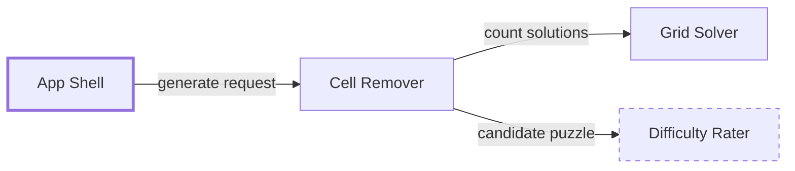

# Subsystem template

File: `<DocDir>/SystemDesign/<Subsystem>.md`, named after the component as its parent names it, in Snake_Case (`Puzzle_Generator.md` for "Puzzle Generator"). Read [subsystems.md](subsystems.md) first for when a piece warrants its own doc and how it relates to its parent.

A subsystem doc is a scoped system design with the same shape as the Overview, so a reader who knows one knows them all. It is bounded the same way: about a page, sections a few lines or a small table. When its own internals outgrow it, promote one of them to a nested subsystem instead of letting this doc grow.

IDs are per document. Cite this doc's IDs bare inside it, and anything from another doc qualified (`Overview:FR1`).

## Template with example

The Puzzle Generator Swift package from the printable Sudoku app, written when rung L4 needed to design its internals. It is a separate build target, so it meets a warrant trigger.

````markdown
# Subsystem: Puzzle Generator

Parent: Overview.md
Status: draft | agreed (<date>)
Mode: new | as-is (adopted <date>)
Build target: PuzzleKit (Swift package, no UI dependency)

## Contract
What the rest of the system may rely on. Changing this section means updating the parent.
- Responsibility: produce a 9×9 puzzle with exactly one solution at a requested difficulty.
- Interface: `generate(difficulty: Difficulty, seed: UInt64?) async throws -> Puzzle`. `Puzzle` holds givens and the solution; same seed, same puzzle.
- Allocated requirements: Overview:FR1 (unique solution), Overview:NFR2 (under 2 s on an M1).
- Crossing risk: Overview:R1 (generator uniqueness and speed).

## Summary
Builds a solved grid, removes cells while the solution stays unique, and rates the result.
Success looks like: 100 seeded puzzles in a test are all unique-solution, each under 2 s, and the requested difficulty matches the rating.

## Scope
| In (this subsystem) | Later | Out |
| --- | --- | --- |
| 9×9, three difficulties | 4×4 and 16×16 | Solving hints for users |

## Headline requirements
- FR1 (must): uniqueness checked by a full solve, not a heuristic. Refines Overview:FR1.
- NFR1: generation under 2 s on an M1. Refines Overview:NFR2.

## Focus areas
1. Cell Remover: removing cells while keeping one solution is where speed is won or lost.

## Components

App Shell is outside this subsystem, shown only as the caller.

| Component | Responsibility | Depth | Doc |
| --- | --- | --- | --- |
| Grid Solver | Fills a grid; counts solutions up to two | designed | none |
| Cell Remover | Removes cells in seeded random order while the solver finds one solution | designed | none |
| Difficulty Rater | Scores a puzzle by the techniques needed | sketched | none |

## Decisions
| ID | Decision | Kind | Status | Why | Revisit when |
| --- | --- | --- | --- | --- | --- |
| D1 | Backtracking solver with bitmask candidates | choice | accepted | simplest that can meet NFR1 | NFR1 fails |

## Assumptions
| ID | Statement | Status | If wrong |
| --- | --- | --- | --- |
| A1 | Counting to two solutions is enough to prove uniqueness | confirmed | none; it is exact |

## Risks (ranked)
| ID | Unknown | Impact | Uncertainty | Cheapest experiment | Depends on |
| --- | --- | --- | --- | --- | --- |
| R1 | Removal to "hard" exceeds 2 s | H | M | Time 100 seeded hard puzzles in a test | Grid Solver |
| R2 | Rater disagrees with how people feel difficulty | M | H | Rate 10 puzzles; owner solves them on paper | Difficulty Rater |

## Open questions
- Q1: Should difficulty be retried until it matches, or reported as found?

## Traceability
| Requirement | Refines | Rung | Status |
| --- | --- | --- | --- |
| FR1 | Overview:FR1 | L4 | planned |
| NFR1 | Overview:NFR2 | L4 | planned |
````

## Notes

- **Contract first.** It is written from the parent's row and is the only part the parent depends on. Keep it short and stable; when it changes, update the parent's row, its depth tag if needed, and any risk that crosses the boundary.
- **Outside components** appear in the diagram only as callers or dependencies, one box each, so the reader sees the boundary. Their internals never appear here.
- **Requirements** allocated from the parent are cited by qualified ID in the Contract. This doc's own `FR`/`NFR` refine them and say so, which keeps traceability unbroken from the Overview to a rung. When this doc is created, refine every requirement the parent marked `(doc pending)`, then drop that marker from the parent's row.
- **Traceability** covers this doc's own requirements; each row names the parent requirement it refines. Fold-back updates the status here, and the parent's row for the allocated requirement only when all its refinements are proven.
- **Risks** that only matter inside stay here. A risk that could break the Contract is also cited from the parent's register (`Puzzle_Generator:R1`).
- At fold-back, rewrite sections to match what was built instead of appending notes, so the doc stays a description of the subsystem, not a history.
